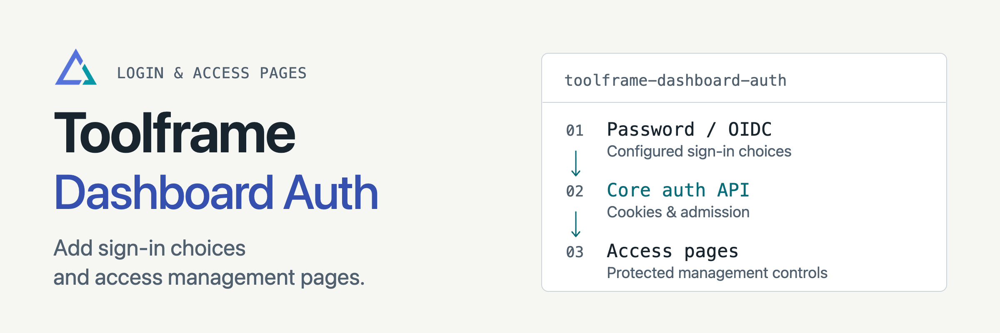

<p align="center">
<picture>
  <source media="(prefers-color-scheme: dark)" srcset="docs/assets/readme-banner-dark.png">
  <source media="(prefers-color-scheme: light)" srcset="docs/assets/readme-banner-light.png">
  
</picture>
</p>

# Toolframe Dashboard Auth

[](https://github.com/toolframe/toolframe-dashboard-auth/actions/workflows/ci.yml?query=branch%3Amain)

Add password and OIDC login choices, plus Streamlit pages for managing access.
Core handles admission and cookies; Toolframe Auth stores credentials and permissions.

## Quick start

In a running [Toolframe application](https://github.com/toolframe/toolframe-core#readme) with Auth enabled:

```sh
toolframe --home APP plugin add pypi:toolframe-dashboard-auth==0.2.2 --enable
```

Use Python 3.14+ and SDK 0.4.1+. The login page works with Web-only applications.
With Streamlit Dashboard installed, open **Access passwords** as a local operator.

**Access:** password, user, agent and MCP-key pages require their corresponding
system permissions. OIDC and MCP keys also require their separate providers.
Public HTTP methods and llms documents retain their own access rules.
This provider stores no credential database or verifier key.

## Guides

| I want to… | Start here |
| --- | --- |
| Manage passwords and expiry | [Access management](docs/access-management.md) |
| Configure application access | [Core authentication](https://github.com/toolframe/toolframe-core/blob/main/docs/authentication.md) |
| Add agent credentials | [MCP Auth](https://github.com/toolframe/toolframe-mcp-auth) · [OIDC Auth](https://github.com/toolframe/toolframe-oidc-auth) |
| Contribute or run checks | [Contributing](CONTRIBUTING.md) · [Verification](docs/ci.md) |
| Publish a package | [Releasing](docs/releasing.md) |

[Releases](https://github.com/toolframe/toolframe-dashboard-auth/releases)

## License

[Apache 2.0](LICENSE), with [NOTICE](NOTICE).
